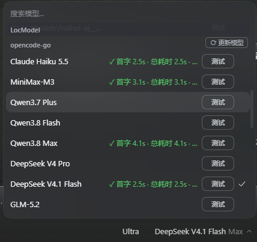

# dsh-model-select-test



DeepSeek Harness 插件：在**现有**模型选择菜单里加入两件事——

1. **每行一个「测试」按钮**：就地测该模型的连通性，不切换当前模型、不关闭菜单、不写聊天记录。
2. **OpenCode Go 组标题右侧一个「⟳ 更新模型」按钮**：一键让宿主拉取 OpenCode Go 官方目录并刷新菜单，与 `dsh-opencode-go-catalog` 插件配合使用（未安装时按钮会显示更新失败，其余功能不受影响）。

不新增页面、侧栏入口或统计面板。

## 行内测试

每行布局：`模型名称 · 测试结果 [测试]`

| 情形 | 行内显示 |
|---|---|
| 进行中 | 测试中…（该行按钮禁用，其他行不受影响） |
| 成功 | `✓ 首字 1.1s · 总耗时 1.2s · 重试 0次` |
| 上游 429 | `✗ 429 上游过载 · 重试 N次` |
| 额度耗尽 | `✗ 额度不足` / `✗ 官方余额不足`（与 429 明确区分） |
| 密钥问题 | `✗ 密钥错误` / `✗ 未配置密钥` / `✗ 密钥无效` |
| 网络类 | `✗ 连接超时` / `✗ 网络错误` / `✗ 上游 5xx` |
| 其他 | `✗ 空响应`、`✗ 上下文超限`、`✗ 超时中止` 等 |

- 结果紧凑显示、过长省略；**悬停**查看完整信息：本次思考强度、每次尝试的耗时与失败原因。
- **成功**以流式正常终结（`stop`）为准，不看 HTTP 200；无终结块立即报失败。
- **首字时间** = 首个可见正文 delta 的时间；**总耗时** = 点击到流终结，含等待与重试。
- **重试**沿用该 provider 注册的 `retryPolicy`（`ctx.llm.providerRetryPolicy`）：可重试代码、maxRetries、`Retry-After` 上限、退避公式与 `dsh-llm-retry` 同一套；`always` 模式有 6 次硬上限并如实显示。
- 测试走 `ctx.llm.stream()`，携带一次性 `sessionId`，让 OpenCode 这类按会话头路由的兼容层保持真实链路；不挂任何工具，输出上限保守。
- 全程 45s 预算；到点报 `超时中止` 并附最后一次失败详情。
- 结果与「提供商＋模型」绑定，保留在本次页面运行周期内；不轮询、不持久化。

## 一键更新模型（OpenCode Go 组头）

- 位置：`opencode-go` 分组标题右侧。
- 点击 → `⟳ 更新模型` → `更新中…` → `✓ 已是最新` / `✓ 已更新 +N -M`（失败显示 `✗ 更新失败`，悬停看原因）。
- 更新后自动重载本会话模型目录，菜单即时反映新增/退役模型；**不切换当前模型、不关闭菜单**。
- 该按钮调用 `dsh-opencode-go-catalog` 插件的 `GET /x-opencode-go-catalog?refresh=1`。

## 安装

```text
plugin_manager action=install_bundle target=<本仓库目录>
```

安装后会：把 shipped 行 `ui-model-selection` 置为 `disabled: true`，并插入本包的一行派生实现——**卸载/停用本 bundle 即自动恢复原菜单**。

## 结构

```text
package.json           dsh.client（与 shipped 相同的 inject 列表）+ exports ./client
cordis.patch.yml       禁用 shipped 行 + 插入本包行
build.py               从 shipped client.js 生成 lib/client.js（4 处定点手术）
lib/index.js           宿主：POST /x-model-test（webServer+connection 鉴权）
lib/client.js          生成的客户端（勿手改）
test/host.test.mjs     路由/重试/超时/分类的 15 项单测
```

### 重新生成客户端（DSH 升级后）

```bash
# 指向当前安装的 shipped 客户端
python build.py "<profile>/node_modules/@deepseek-ai/dsh-client-ui-model-selection/lib/client.js"
# 或
DSH_MODEL_SELECTION_CLIENT=".../lib/client.js" python build.py
```

build.py 做 4 处手术，锚点不唯一直接报错，不会静默错改：

1. 模块 id 改为 `dsh-model-select-test`；
2. 模型行 children 注入 `...dshModelTestCells(group, model)`；
3. 模型分组渲染包一层 `dshModelTestGroup(...)`（一键更新按钮）；
4. 工厂尾部追加测试子系统（store、请求、class 组件、CSS）。

其余字节与 shipped 完全一致（键盘导航、搜索、effort 面板保持原行为）。

## 已验证（DSH 0.2.2-rc.1 实测）

- 30 行模型 = 30 按钮 = 30 结果槽；搜索过滤后行数与按钮数同步。
- 点击「测试」：菜单保持打开（busy 中与结束后均 `aria-expanded=true`），当前模型不变（触发器 label 与行 `aria-checked` 不变）。
- 行内 `✓ 首字 1.1s · 总耗时 1.2s · 重试 0次`，悬停含 effort 与每 attempt 明细。
- 组头按钮：`⟳ 更新模型` → `✓ 已是最新`，菜单不关、模型不变。

## 许可证

MIT。`lib/client.js` 是基于 `@deepseek-ai/dsh-client-ui-model-selection`（MIT）的修补衍生版，上游版权归其作者，本仓库仅新增 build.py 中列明的补丁。
